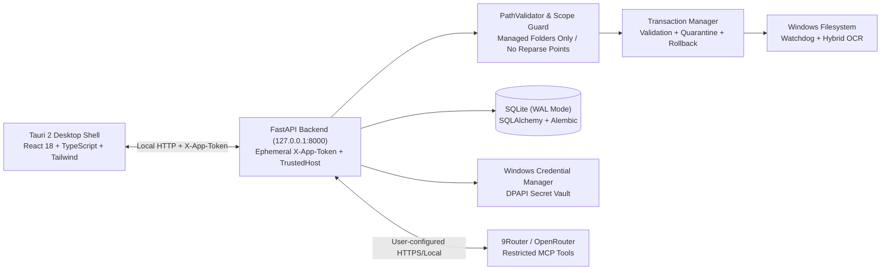

# FileNest — Smart Desktop & Storage Manager

[](https://github.com/imanfauzi29/Smart-File-Manager)
[](https://tauri.app/)
[](https://react.dev/)
[](https://fastapi.tiangolo.com/)
[](https://www.sqlite.org/)
[](LICENSE)
[](https://trakteer.id/iman_fauzi9)

**FileNest** is a production-ready Windows desktop application for analyzing, organizing, monitoring, and safely managing local storage and files with AI-assisted planning. Built on **Tauri 2 (Rust)**, **React 18 + TypeScript**, and a local **FastAPI (Python)** backend, FileNest combines deterministic filesystem safety, transactional change plans with rollback, hybrid OCR, and privacy-first AI gateway integration.

> **Safety First:** AI models only analyze metadata and generate structured change plans. The frontend has zero direct filesystem access—every mutation is validated, approved, executed, and audited by the backend **Transaction Manager** strictly inside user-registered **Managed Folders**.

---

## Key Features

- **Dashboard Overview**
  Real-time storage utilization telemetry, storage history charts, folder distribution breakdown, recent activity feed, background job monitor, and actionable recommendations.
- **3-Pane Files Manager with Bounded Preview & OCR**
  Native desktop-style explorer with folder tree, virtualized/structured file browser, context menus, detail inspector, bounded image/text preview streaming, and instant OCR text extraction.
- **Storage Analyzer & Duplicate Finder**
  Identifies large files, empty folders, file-type distribution, and content-hash duplicate groups, allowing safe review-backed cleanup plans rather than blind deletion.
- **Smart Organization & Protected Folder Detection**
  Generates structured folder reorganization plans (`by_category`, date, or custom strategies) while automatically detecting and protecting software projects, SDKs, and DLL/tool bundles (such as `platform-tools`, `node_modules`, `.git`, or runtime directories) from accidental disassembly.
- **Smart Rename with Hybrid OCR**
  Extracts text from images and PDFs using ultra-fast **Windows Native OCR (`winocr`)** with **PaddleOCR PP-OCRv4** fallback (single-item on-demand and background batch processing) to propose descriptive, collision-free filenames.
- **Review Changes & Transaction Manager (Rollback & Undo)**
  Human-in-the-loop approval workflow separating `draft`/`pending_review`, `approved`, `executed`, and `rejected` plans. Performs pre-execution TOCTOU checks, collision detection, local quarantine staging, best-effort automatic rollback on failure, and post-execution undo.
- **Real-Time Watchdog Monitoring & Rules Automation**
  Persistent `watchdog` directory observers with configurable debouncing, ignore patterns, event inspection charts, and scoped automated rules that divert to **Review Changes** on any conflict or risk.
- **Contextual AI Assistant (9Router & OpenRouter Fallback)**
  Slide-over assistant scoped strictly to registered Managed Folders via a restricted MCP tool layer (`plan_create_*`, read-only metadata tools—never unrestricted shell or delete access), with OpenAI-compatible **9Router** gateway support and optional **OpenRouter** automatic fallback.
- **Command Palette & Desktop Integration**
  Global `Ctrl+K` quick navigation, light/dark themes, Windows system tray minimization, optional Windows startup (`HKCU\...\Run`) integration, and in-place installer update discovery.

---

## UI Previews

<details>
<summary>View Application Design Previews (Dashboard, Files, Storage, Organize, Smart Rename, Review Changes, Monitoring, History, Managed Folders, Settings)</summary>

| Module | Preview |
|---|---|
| **Dashboard Overview** |  |
| **Files Manager** |  |
| **Storage Analyzer** |  |
| **Organization Planner** |  |
| **Smart Rename & OCR** |  |
| **Review Changes** |  |
| **Real-Time Monitoring** |  |
| **Audit & Execution History** |  |
| **Managed Folders** |  |
| **Settings & Security** |  |

</details>

---

## Architecture



### Technology Stack

| Layer | Technologies |
|---|---|
| **Desktop Shell** | Tauri 2 (Rust), System Tray, Native Folder/File Dialogs (`@tauri-apps/plugin-dialog`), NSIS & MSI Windows Bundler |
| **Frontend** | React 18, TypeScript (Strict), Vite 6, Tailwind CSS, Lucide React, Recharts |
| **Backend** | Python 3.11+, FastAPI, Uvicorn, Pydantic v2, Pydantic Settings |
| **Persistence** | SQLite 3 (WAL mode, foreign keys enforced), SQLAlchemy 2, Alembic |
| **OCR & Extraction** | Windows Native OCR (`winocr`), PaddleOCR PP-OCRv4, PyPDFium2, Pillow |
| **Monitoring** | Watchdog background observers with persistent SQLite event & job state |
| **Credential Vault** | Windows Credential Manager via `keyring` (DPAPI-encrypted) |

---

## Security & Credential Architecture

FileNest is hardened for local Windows desktop production use:

- **Zero Exposed Secrets:** API keys (9Router, OpenRouter) are stored exclusively in **Windows Credential Manager** via `CredentialService`—never in `.env`, SQLite, frontend bundles, or logs.
- **Automatic Secret Redaction:** `SensitiveDataFilter` and `AuditLogRepository` automatically mask/redact `sk-*`, `Bearer` tokens, `api_key`, `password`, and secret fields before logging or persisting audit records.
- **Ephemeral Session Token & DNS Rebinding Protection:** All `/api/v1/*` routes (excluding public health/handshake paths) require a runtime-generated 32-byte `X-App-Token` negotiated via `/api/v1/auth/session` with strict `Origin`, `TrustedHostMiddleware`, and Tauri CSP enforcement.
- **SSRF & Exfiltration Guards:** `validate_probe_url` blocks `file://`, `gopher://`, embedded URL credentials, cloud metadata IPs (`169.254.169.254`), and link-local ranges, and never attaches stored keys to untrusted endpoint overrides.
- **Strict Filesystem Confinement:** Only manually registered Managed Folders are accessible. `PathValidator` rejects Windows system directories (`C:\Windows`, `Program Files`), drive roots, path traversal, Alternate Data Streams (ADS), reserved device names, symbolic links, and Windows junctions.
- **ReDoS & Decompression Bomb Protection:** Rule regex evaluation enforces pattern validation and execution timeouts; image preview and OCR enforce a 50 MP pixel budget and 50 MB size cap.

---

## Getting Started

### Prerequisites

- **OS:** Windows 10 (1903+) / Windows 11 (64-bit) with WebView2 Evergreen Runtime
- **Node.js:** `>= 18`
- **pnpm:** `>= 9`
- **Python:** `3.11+` (64-bit)
- **Rust & Cargo + Visual Studio C++ Build Tools (2022):** Required for building the Tauri 2 native desktop binary and Windows installers

### Installation & Setup

1. **Clone the repository:**
   ```powershell
   git clone https://github.com/imanfauzi29/Smart-File-Manager.git
   cd Smart-File-Manager
   ```

2. **Install frontend dependencies:**
   ```powershell
   pnpm install
   ```

3. **Create a Python virtual environment and install backend dependencies:**
   ```powershell
   python -m venv .venv
   .\.venv\Scripts\python -m pip install --upgrade pip
   .\.venv\Scripts\pip install -r requirements.txt
   ```

4. **Create local runtime configuration (optional):**
   ```powershell
   copy .env.example .env
   ```
   > Never place real API keys in `.env` or commit `.env` to Git. Configure AI gateway keys directly inside the app (**Settings -> AI & Gateway**), which saves them securely in Windows Credential Manager.

---

## Running the Application

### Option 1: One-Click Desktop Launcher (Windows)
```powershell
.\run-desktop.bat
```
Or with the PowerShell supervisor:
```powershell
.\scripts\start-filenest.ps1
```

### Option 2: Run Frontend & Backend Separately
- **Backend (FastAPI on `http://127.0.0.1:8000`):**
  ```powershell
  pnpm run backend:dev
  ```
- **Frontend + Tauri Desktop Shell (Live Reload):**
  ```powershell
  pnpm run desktop
  ```

---

## Building for Production (Windows Installer)

FileNest ships with a single-command standalone Windows installer pipeline using **PyInstaller** + **Tauri 2 (NSIS & MSI)**.

- **Lite Installer (Default — fast build using Windows Native OCR):**
  ```powershell
  .\build.bat lite
  # or
  pnpm run build:installer:lite
  ```

- **Full Offline Installer (Includes bundled PaddleOCR PP-OCRv4 weights):**
  ```powershell
  .\build.bat full
  # or
  pnpm run build:installer:full
  ```

- **Quick Rebuild (Frontend + Tauri shell only, reusing existing packaged backend):**
  ```powershell
  .\build.bat quick
  # or
  pnpm run build:installer:quick
  ```

Generated installers are collected into `release/` (and `src-tauri/target/release/bundle/`):
- `FileNest_0.1.0_x64-setup.exe` (NSIS Installer)
- `FileNest_0.1.0_x64_en-US.msi` (MSI Enterprise Installer)

For detailed operational, database backup, and deployment procedures, see [docs/WINDOWS_DEPLOYMENT.md](docs/WINDOWS_DEPLOYMENT.md) and [docs/PACKAGING_AND_BUILD.md](docs/PACKAGING_AND_BUILD.md).

---

## Testing & Verification

- **Run Backend Test Suite:**
  ```powershell
  pnpm run test
  # or directly:
  .\.venv\Scripts\pytest backend/tests
  ```

- **Run Frontend Type Check & Production Bundle:**
  ```powershell
  pnpm run build
  ```

---

## Project Structure

```text
├── backend/                    # Python FastAPI backend
│   ├── alembic/                # Alembic SQLite schema migrations
│   ├── app/
│   │   ├── api/v1/endpoints/   # REST API routers
│   │   ├── core/               # Config, security middleware, redacted logging
│   │   ├── db/                 # SQLAlchemy models, repositories, WAL session setup
│   │   ├── schemas/            # Pydantic v2 validation schemas
│   │   ├── services/           # Business logic, Transaction Manager, OCR, AI, Watchdog
│   │   ├── launcher.py         # Frozen production backend entrypoint
│   │   └── main.py             # FastAPI application factory & lifespan
│   └── tests/                  # Pytest unit, integration, and security test suites
├── design/                     # UI design specifications and reference previews
├── docs/                       # Deployment, packaging, and filesystem safety docs
├── scripts/                    # PyInstaller & Windows installer build/run scripts
├── src/                        # React 18 + TypeScript desktop UI
│   ├── components/             # Layout, navigation, command palette, AI assistant
│   ├── contexts/               # Theme & preferences context
│   ├── features/               # Domain feature views (dashboard, files, storage, etc.)
│   ├── services/               # Typed frontend API client with X-App-Token handling
│   └── types/                  # Shared TypeScript interfaces
├── src-tauri/                  # Tauri 2 Rust native shell, tray, capabilities, NSIS hooks
├── .env.example                # Non-sensitive environment configuration template
├── alembic.ini                 # Alembic configuration
├── build.bat                   # Root Windows installer build script
├── LICENSE                     # MIT License
├── package.json                # Frontend & build scripts
├── requirements.txt            # Python dependencies
└── run-desktop.bat             # Development desktop launcher
```

---

## Support

If you find **FileNest** helpful and would like to support its continued development:

[](https://trakteer.id/iman_fauzi9)

- Trakteer: [https://trakteer.id/iman_fauzi9](https://trakteer.id/iman_fauzi9)

---

## License

This project is licensed under the **MIT License** — see the [LICENSE](LICENSE) file for details.
