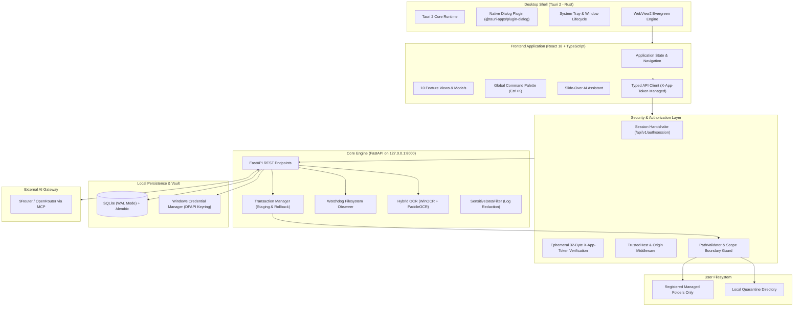
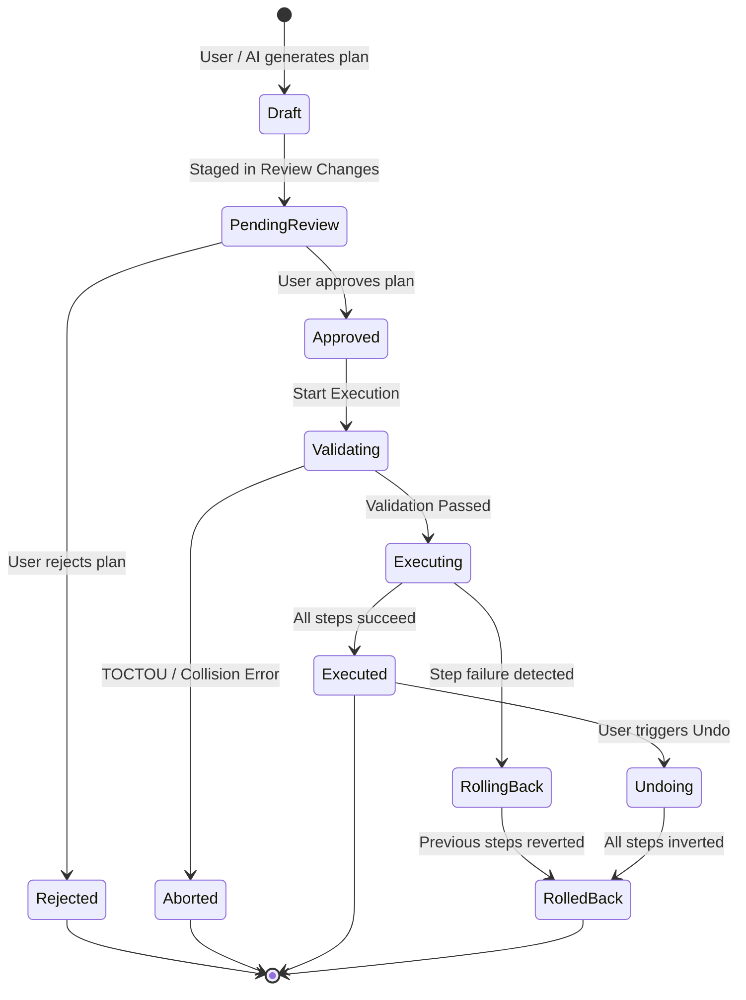

# FileNest Technical Architecture & Security Specification

This document details the architectural design, security controls, persistence layer, transaction safety guarantees, and AI gateway integrations of **FileNest**.

---

## 1. High-Level System Architecture

FileNest adopts a modern desktop architecture separating the presentation shell from the local core engine:

---

## 2. Frontend Layer

- **Framework:** React 18.3+ with TypeScript (Strict mode enabled).
- **Desktop Shell:** Tauri 2.2+ utilizing Microsoft WebView2 Evergreen.
- **Build Tool:** Vite 6 with `@vitejs/plugin-react`.
- **CSS & UI Components:** Tailwind CSS 3.4+, custom shadcn/ui components built on Radix UI primitives.
- **Icons:** Lucide React (`lucide-react`) exclusively.
- **Charts & Telemetry:** Recharts 3.10+ for responsive time-series and categorical visualization.

### State & Navigation Architecture
- **Tab Routing:** Centrally managed in `src/App.tsx` across the 10 domain feature views:
  `dashboard`, `files`, `storage`, `organization`, `smart-rename`, `review-changes`, `monitoring`, `history`, `managed-folders`, and `settings`.
- **Inter-Module Deep Linking:** Modules pass navigation states (e.g., jumping from Storage duplicate findings directly into Files Manager or Review Changes).
- **Session Handshake:** On startup, `ApiService.initSession()` requests an ephemeral session token from `/api/v1/auth/session` before making any data requests.

---

## 3. Backend & Core Engine

- **Framework:** Python 3.11+ with FastAPI and Uvicorn.
- **Data Validation:** Pydantic v2 schemas for all request/response models.
- **Filesystem Observation:** Python `watchdog` monitoring registered directories with event debouncing.
- **Process Model:** Runs locally bound to `127.0.0.1:8000`. In packaged releases, the backend is compiled with PyInstaller and managed by Tauri as a supervised sidecar process.

---

## 4. Security Architecture

FileNest enforces defense-in-depth across the entire application stack:

### 4.1 Ephemeral Session Token Handshake
1. The backend generates a cryptographically secure 32-byte hexadecimal token at startup.
2. The frontend negotiates this token over a local handshake endpoint `/api/v1/auth/session` (subject to strict `Origin` and `TrustedHost` checks).
3. All subsequent API calls require this token in the `X-App-Token` HTTP header. Requests lacking the token receive `401 Unauthorized`.

### 4.2 Strict Scope & Path Validation
The `PathValidator` service enforces strict boundaries before every filesystem read or mutation:
- **Registered Folder Confinement:** Operations are rejected if the target path does not resolve within an explicitly registered Managed Folder.
- **System Directory Blocking:** Hardcoded blacklists forbid access to Windows system directories:
  - `C:\Windows`, `C:\Program Files`, `C:\Program Files (x86)`
  - User profiles, system `AppData` folders, root system drives (`C:\`)
- **Reparse Point & Symlink Defense:** Symbolic links, junctions, and reparse points are detected and blocked to prevent directory traversal outside managed boundaries.
- **Alternate Data Streams (ADS) & Device Names:** Path normalization rejects Windows reserved device names (`CON`, `PRN`, `AUX`, `NUL`, `COM1-9`, `LPT1-9`) and NTFS stream specifiers (`:`).

### 4.3 Windows DPAPI Credential Vault
- Sensitive API keys for AI gateways (9Router, OpenRouter) are encrypted with the logged-in Windows user's master key via the **Windows Data Protection API (DPAPI)** using the `keyring` library.
- Keys are never persisted in `.env` files, plaintext configurations, SQLite databases, or logs.

### 4.4 Secret Redaction in Logs & Audit Records
- `SensitiveDataFilter` intercepts all log records.
- Patterns matching `sk-*`, `Bearer *`, `api_key`, `password`, and authentication headers are masked (`[REDACTED]`) before reaching console or disk logs.

---

## 5. Transaction Safety & Rollback Engine

Every mutating filesystem operation follows an atomic, verifiable transaction model:

### Key Safety Mechanisms
1. **TOCTOU (Time-of-Check to Time-of-Use) Verification:**
   Immediately prior to executing each step, the Transaction Manager confirms that the file exists, has not been modified by another process (matching file size and modification time), and is not locked.
2. **Local Quarantine Staging:**
   Files slated for removal are moved into a hidden `.filenest_quarantine` directory within the Managed Folder rather than unlinked.
3. **Atomic Compensation Rollback:**
   If step $N$ of a 50-step transaction fails (e.g., due to an unexpected disk error), the engine catches the exception and systematically reverses steps $N-1$ through $1$.
4. **Post-Execution Undo Journal:**
   Every executed transaction writes an undo manifest to SQLite, enabling complete post-execution rollback from the History view.

---

## 6. Persistence & Database Design

- **Database Engine:** SQLite 3 with Write-Ahead Logging (`PRAGMA journal_mode=WAL;`).
- **ORM:** SQLAlchemy 2.0 with strict foreign key constraints (`PRAGMA foreign_keys=ON;`).
- **Migrations:** Alembic manages schema versioning and deterministic schema upgrades.

### Core Tables
- `managed_folders`: Registered directories, status, last scan timestamp, disk quota, and exclusions.
- `file_records`: Cached metadata (canonical path, size, extension, modified time, SHA-256 hash, MIME type).
- `change_plans`: Staged, approved, executed, and rejected plan headers.
- `change_plan_steps`: Individual atomic operations (source path, destination path, operation type, status).
- `audit_logs`: Tamper-evident execution trail of all transactions and system events.
- `monitoring_events`: High-frequency filesystem change records captured by Watchdog observers.
- `automation_rules`: User-defined background triggers and condition specifications.

---

## 7. AI Gateway & MCP Architecture

FileNest integrates AI as an advisory and planning assistant without granting it destructive capabilities:

### Hermes & 9Router Integration
- FileNest connects to **9Router** (a high-performance local AI gateway compatible with the OpenAI API format) or fallback endpoints like OpenRouter.
- The assistant is exposed strictly via Model Context Protocol (MCP) tools that accept and return validated Pydantic schemas.

### AI Restrictions & Boundaries
| Allowed for AI | Strictly Forbidden for AI |
|---|---|
| Querying file metadata and counts | Direct filesystem deletion or modification |
| Recommending category taxonomies | Running raw shell commands or Python scripts |
| Proposing descriptive filenames based on OCR text | Accessing files outside Managed Folders |
| Generating structured change plans | Bypassing Review Changes approval |

All change proposals generated by AI are delivered as `Draft` plans to **Review Changes**, requiring explicit human approval before any disk operations occur.
