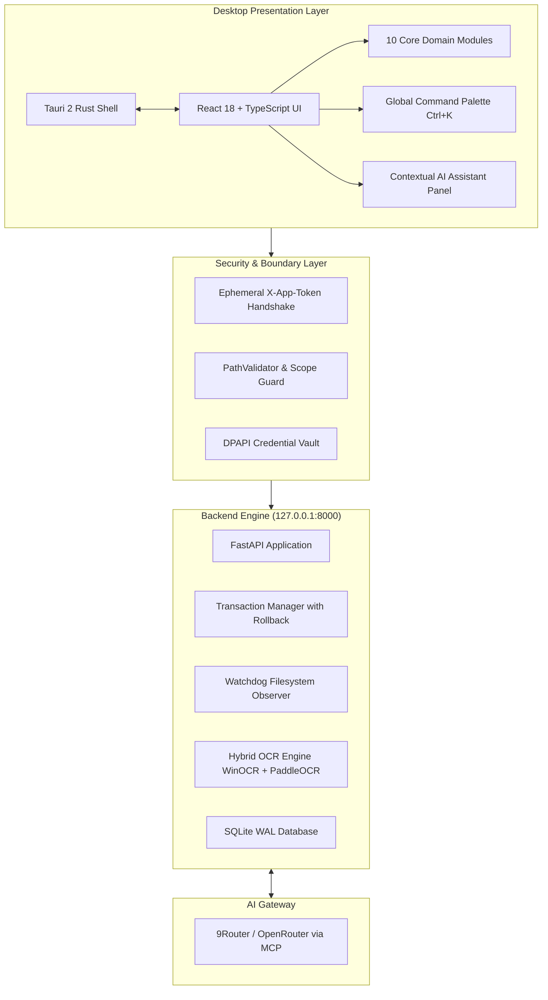

# FileNest Documentation Hub

Welcome to the comprehensive documentation suite for **FileNest (Smart Desktop & Storage Manager)**.

FileNest is a high-performance Windows desktop application built with **Tauri 2 (Rust)**, **React 18 + TypeScript**, and a local **FastAPI (Python)** backend. It combines strict filesystem safety, deterministic transactional operations with rollback, hybrid OCR, and privacy-first local AI planning.

---

## Documentation Navigation

| Document | Description | Target Audience |
|---|---|---|
| [**User & Feature Guide**](USER_GUIDE.md) | Comprehensive manual detailing all 10 modules, interactive workflows, keyboard shortcuts, and UI features with screenshots. | End Users, Power Users, QA |
| [**UI Previews & Design Catalog**](UI_PREVIEWS.md) | Visual reference catalog showcasing all primary screens, modal dialogs, component hierarchies, and theme previews. | Designers, Frontend Devs, QA |
| [**Technical Architecture**](ARCHITECTURE.md) | Deep dive into Tauri 2 IPC, FastAPI REST architecture, SQLite WAL schema, Transaction Manager, and AI Gateway integration. | Developers, Architects |
| [**Filesystem Safety Verification**](FILESYSTEM_SAFETY_VERIFICATION.md) | Audit criteria, path validation matrices, reparse point protections, collision resolution, and quarantine mechanics. | Security Auditors, Developers |
| [**Packaging & Build Guide**](PACKAGING_AND_BUILD.md) | Instructions for PyInstaller backend compilation (Lite vs Full modes), Vite bundle, and Tauri NSIS/MSI installer creation. | DevOps, Release Engineers |
| [**Windows Deployment & Operations**](WINDOWS_DEPLOYMENT.md) | Windows production deployment, service lifecycle, DPAPI credential storage, log rotation, and database maintenance. | System Administrators |

---

## Key Highlights

- **Zero Direct Frontend Filesystem Access:** The frontend cannot directly delete, move, or modify files. Every filesystem change is submitted as a structured plan to the backend Transaction Manager.
- **Strict Scope Boundaries:** Operations are restricted strictly to user-registered **Managed Folders**. Windows system folders, drive roots, and symbolic links/junctions are blocked.
- **Rollback & Post-Execution Undo:** Every file transaction supports pre-execution collision checks, atomic quarantine staging, automatic rollback on error, and historical undo.
- **Encrypted Credential Storage:** Sensitive API keys for AI gateways (9Router, OpenRouter) are stored exclusively in the Windows Credential Manager (DPAPI), never in plaintext files or SQLite.

---

## Quick Reference: Core Modules

1. [**Dashboard Overview**](USER_GUIDE.md#1-dashboard-overview) — Storage telemetry, trend charts, folder breakdown, and recent activity.
2. [**Files Manager**](USER_GUIDE.md#2-files-manager) — 3-pane file browser with virtualized lists, bounded previews, and instant OCR.
3. [**Storage Analyzer**](USER_GUIDE.md#3-storage-analyzer--duplicate-finder) — Large files, duplicate hash clusters, empty folders, and review-backed cleanups.
4. [**Smart Organization**](USER_GUIDE.md#4-smart-organization-planner) — Rule-based and categorized folder reorganization with protected folder detection.
5. [**Smart Rename & OCR**](USER_GUIDE.md#5-smart-rename--hybrid-ocr) — High-speed WinOCR and PaddleOCR extraction for descriptive, collision-free naming.
6. [**Review Changes**](USER_GUIDE.md#6-review-changes--transaction-manager) — Human-in-the-loop plan staging, diff inspection, execution, and rollback.
7. [**Real-Time Monitoring**](USER_GUIDE.md#7-real-time-monitoring--rules-automation) — Persistent Watchdog observers, event graphs, and conflict-diverted automation.
8. [**Audit & Execution History**](USER_GUIDE.md#8-audit--execution-history) — Immutable execution logs, operation traces, and one-click transaction rollback.
9. [**Managed Folders**](USER_GUIDE.md#9-managed-folders) — Boundary management, drive root handling, path inclusion/exclusion, and rescanning.
10. [**Settings & Security**](USER_GUIDE.md#10-settings--security) — DPAPI credential vault, AI model selection, scan limits, and system startup.
