# FileNest — Visual UI Previews & Design Catalog

This document provides a comprehensive visual reference of all screens, modular views, modal dialogs, and interactive states in **FileNest (Smart Desktop & Storage Manager)**.

All screenshots shown below represent the actual desktop UI and are stored directly in `docs/screenshots/` for version control and offline documentation.

---

## Screen Directory

1. [Dashboard Overview](#1-dashboard-overview)
2. [Files Manager (3-Pane Explorer)](#2-files-manager-3-pane-explorer)
3. [Files Manager (Modal & Detail View)](#3-files-manager-modal--detail-view)
4. [Storage Analyzer & Duplicate Finder](#4-storage-analyzer--duplicate-finder)
5. [Smart Organization Planner](#5-smart-organization-planner)
6. [Smart Rename & Hybrid OCR](#6-smart-rename--hybrid-ocr)
7. [Review Changes & Transaction Manager](#7-review-changes--transaction-manager)
8. [Real-Time Monitoring & Events](#8-real-time-monitoring--events)
9. [Audit & Execution History](#9-audit--execution-history)
10. [Managed Folders](#10-managed-folders)
11. [Settings & General Configuration](#11-settings--general-configuration)
12. [Settings Details & AI Gateway](#12-settings-details--ai-gateway)

---

## 1. Dashboard Overview

The **Dashboard** gives users immediate insight into storage usage, recent activity across all managed folders, and active background processing jobs.

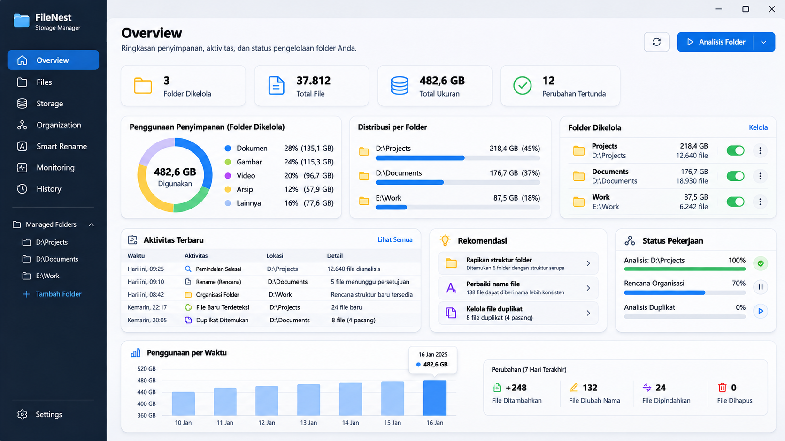

### Key UI Components
- **Top Metric Cards:** Four responsive summary cards highlighting Total Storage, Used Space, Free Space, and Active Managed Folders.
- **Storage Donut Chart:** Interactive SVG chart categorizing disk space by file type (Documents, Images, Media, Code, Archives, Others).
- **Storage Trend Line:** 30-day historical chart showing space usage progression and cleanup impact.
- **Managed Folders Table:** Compact status table of all active directories with quick-scan buttons.
- **Recent Activities Feed:** Timeline feed of newly indexed, modified, or quarantined files.
- **Background Worker Status:** Real-time progress bar for active scans and hash jobs.

---

## 2. Files Manager (3-Pane Explorer)

The **Files Manager** replicates the desktop explorer experience with integrated metadata inspection, bounded previews, and OCR extraction.

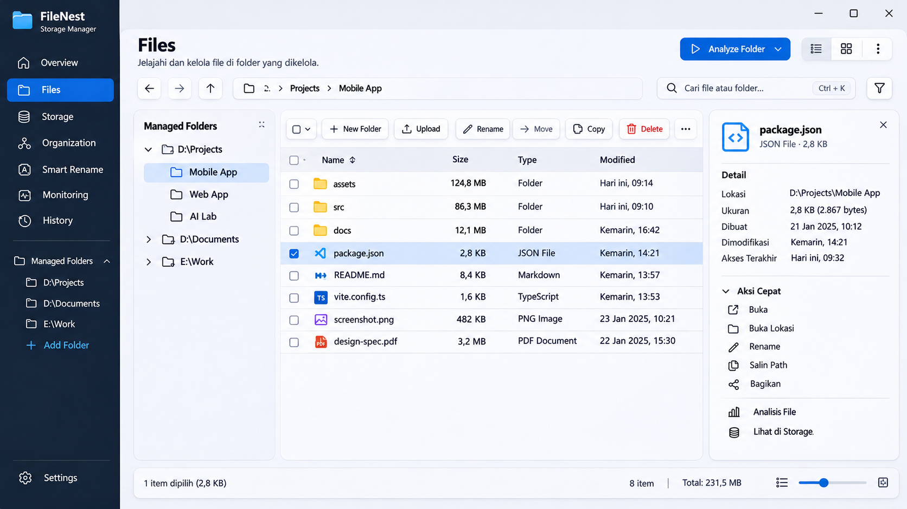

### Layout Structure
- **Left Column:** Folder tree navigator with expand/collapse nodes, showing all subfolders within registered Managed Folders.
- **Center Column:** Main virtualized file table with sortable columns (Name, Size, Modified Date, Type), search filter input, and extension tag pills.
- **Right Column:** Inspector pane displaying rich metadata, SHA-256 hash, and bounded file preview.
- **Global Actions Bar:** Create Folder, Refresh, View Switcher (List / Grid), and Sort Mode.

---

## 3. Files Manager (Modal & Detail View)

When deep inspection or operations are initiated on a file, contextual modals and panels provide safe, focused interaction.

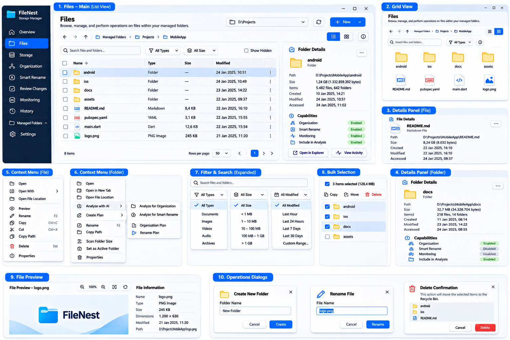

### Modal Capabilities
- **File Preview Modal:** Bounded image rendering (strict 50 MB / 50 MP caps) and formatted text viewer.
- **Instant OCR Extraction:** Displays recognized text side-by-side with the document image.
- **Move / Copy Modal:** Folder destination picker confined strictly to active Managed Folders.
- **Safe Delete Modal:** Explains quarantine behavior and requires explicit confirmation.

---

## 4. Storage Analyzer & Duplicate Finder

The **Storage Analyzer** helps users find wasted disk space and duplicate files without risking accidental loss of important data.

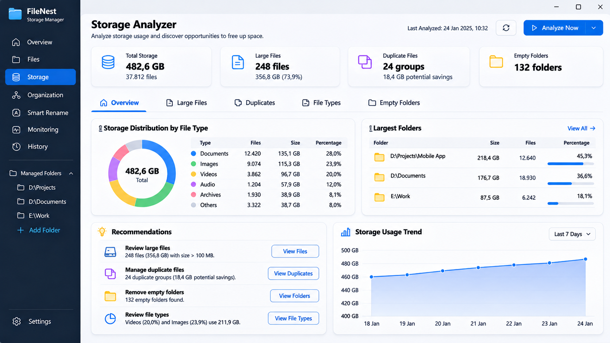

### Key UI Components
- **Storage Breakdown Bars:** Visual representation of space consumption grouped by file extensions.
- **Duplicate Clusters Tab:** Identifies identical files by byte size and SHA-256 hash with *Keep Newest*, *Keep Oldest*, or *Manual Select* buttons.
- **Large Files Tab:** Highlights files exceeding chosen size thresholds (e.g., > 100 MB).
- **Empty Folders Tab:** Finds unused, empty directory hierarchies for batch removal.
- **Create Cleanup Plan:** Stages proposed removals into **Review Changes** for safe verification.

---

## 5. Smart Organization Planner

The **Organization Planner** automatically restructures chaotic folders into clean, organized hierarchies.

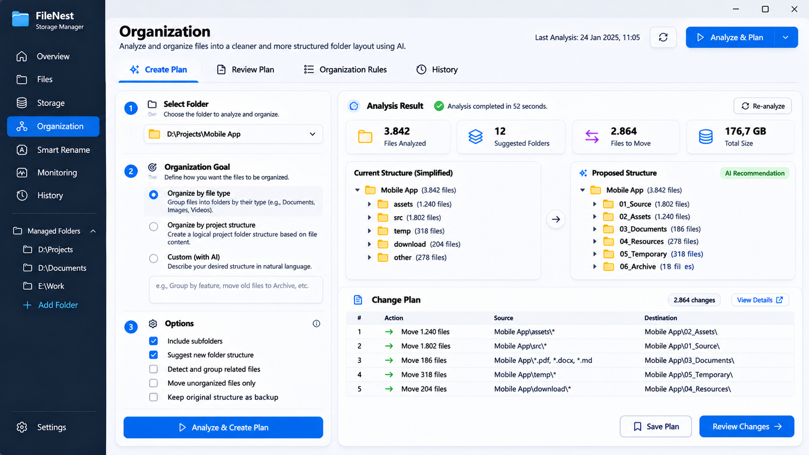

### Key UI Components
- **Folder Selector:** Choose which Managed Folder to analyze and restructure.
- **Strategy Selector:** Choose between *By Category* (Documents, Media, Code, Archives) or *By Date* (Year/Month).
- **Protected Folder Detection Banner:** Highlights protected software repositories (`.git`, `node_modules`, `.venv`, SDKs) that will be preserved.
- **Proposed Tree Preview:** Visual before/after tree diff showing where each file will be placed.
- **Generate Plan Button:** Previews the organization plan and hands it off to Review Changes.

---

## 6. Smart Rename & Hybrid OCR

The **Smart Rename** module extracts text from images and PDF documents to generate meaningful, standardized filenames.

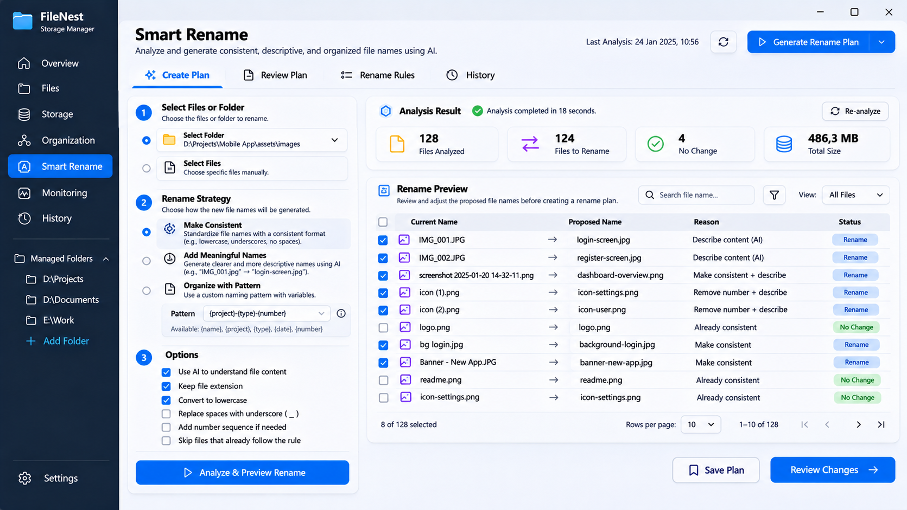

### Key UI Components
- **OCR Engine Selector:** Toggle between Windows Native OCR (`winocr`) and PaddleOCR (PP-OCRv4).
- **Batch Document List:** Shows all candidate images or PDFs with thumbnail previews.
- **Side-by-Side Naming Table:** Displays Original Name, Extracted Text / Invoice Number, and Proposed New Name.
- **Inline Editing:** Click any proposed name to edit it before finalizing.
- **Collision Detection:** Flags any naming collision in red with automatic suffix options.

---

## 7. Review Changes & Transaction Manager

The **Review Changes** screen serves as the central approval gate for all filesystem mutations.

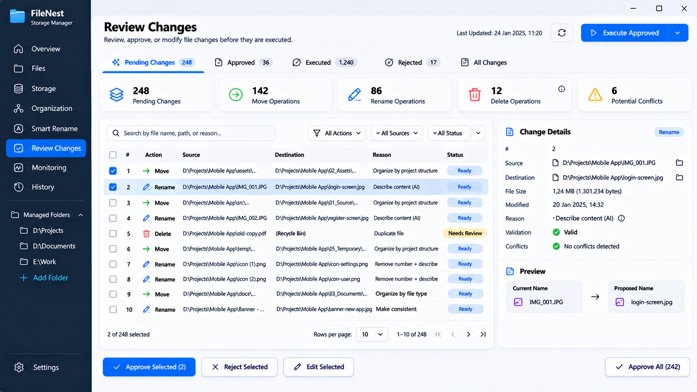

### Key UI Components
- **Plan Header:** Shows Plan ID, Source Feature, Operation Count, and Total Byte Impact.
- **Operation Filter Tabs:** Filter between All, Move, Rename, and Quarantine operations.
- **Path Diff Table:** Clear comparison of source path versus destination path with status chips.
- **Pre-Execution TOCTOU Indicator:** Displays verification status of file existence, permissions, and hash match.
- **Action Buttons:**
  - *Approve & Execute:* Runs the transaction with atomic rollback protection.
  - *Reject Plan:* Discards the proposed changes without modifying any files.
  - *Undo Transaction:* Reverts an executed plan back to its original filesystem state.

---

## 8. Real-Time Monitoring & Events

The **Monitoring** view tracks live filesystem events across all registered folders using Windows `watchdog` observers.

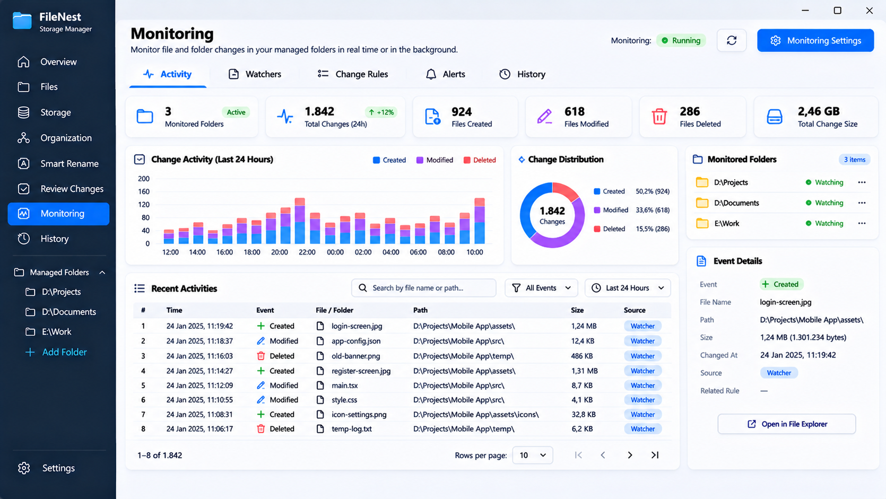

### Key UI Components
- **Live Event Stream:** Timestamped list of filesystem events (`CREATED`, `MODIFIED`, `DELETED`, `MOVED`).
- **Telemetry Charts:** Real-time graphs showing event rates per minute and activity distribution per directory.
- **Event Filter:** Filter by Event Type, File Extension, or Managed Folder.
- **Automation Rules:** Configurable background triggers that automatically stage plans when specific conditions are met.

---

## 9. Audit & Execution History

The **History** module provides a complete, searchable record of every action taken by FileNest.

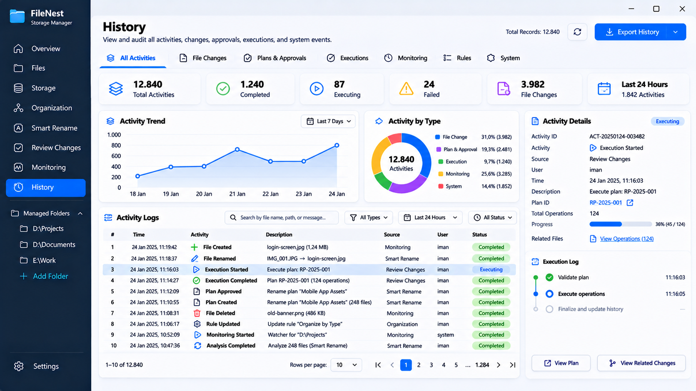

### Key UI Components
- **Execution Log Table:** Lists every past transaction with Date, Operation Count, Status, Trigger Source, and Rollback availability.
- **Transaction Details Drawer:** Shows the individual steps and status of each file in a transaction.
- **Rollback Trigger Button:** One-click undo for any past transaction.
- **Export Audit Log:** Export execution records to CSV or JSON for compliance and record-keeping.

---

## 10. Managed Folders

The **Managed Folders** view defines and secures the filesystem boundaries of the application.

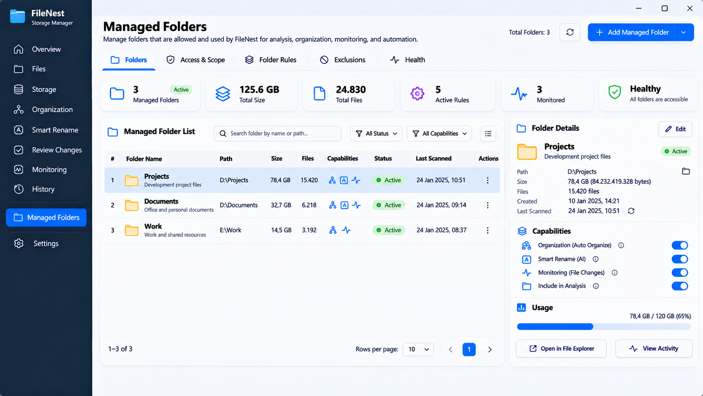

### Key UI Components
- **Register Folder Button:** Opens the native Windows folder picker to add a new folder or drive root.
- **Registered Folders Cards/Table:** Displays folder path, total files, total size, status, and last scan time.
- **Rescan Button:** Triggers an immediate background rescan of the selected directory.
- **Exclusion Management:** Add subfolder exclusion patterns (e.g., ignore `.git`, `node_modules`, `temp`).
- **Unregister Option:** Safely removes a folder from FileNest's database without touching the files on disk.

---

## 11. Settings & General Configuration

The **Settings** module manages application preferences, system integration, and security controls.

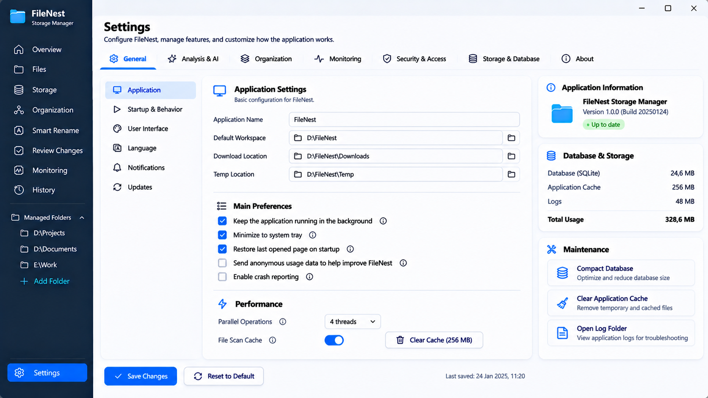

### Key UI Components
- **Appearance & Theme:** Light, Dark, or System mode selector.
- **Windows Integration:** Run on Windows Startup and Minimize to System Tray toggles.
- **Scanning Limits:** File size caps and image decompression pixel budgets.
- **Database & Storage Status:** SQLite database size, WAL status, and cache management.

---

## 12. Settings Details & AI Gateway

Granular configuration for the AI Gateway (9Router & OpenRouter) and Windows Credential Vault.

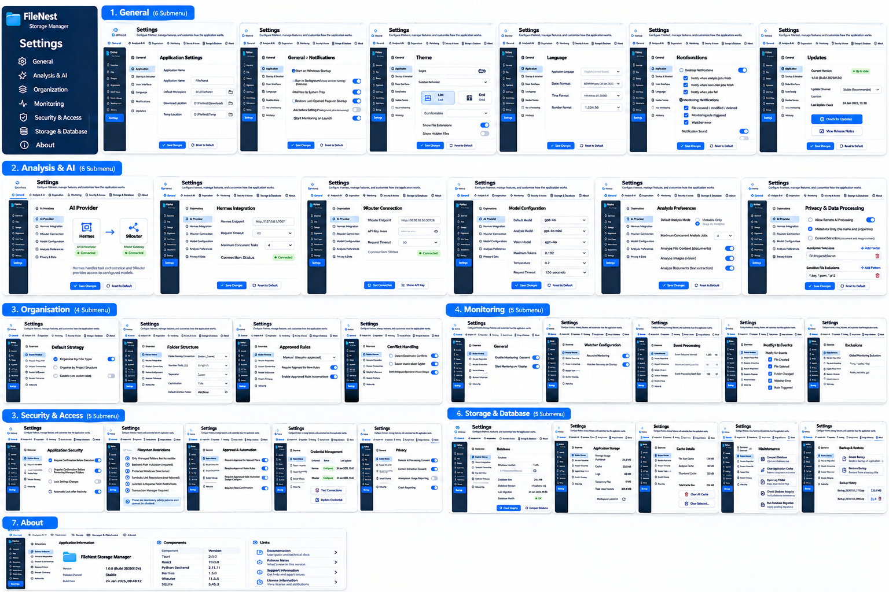

### Key UI Components
- **AI Gateway Endpoint:** Configurable 9Router / OpenAI-compatible endpoint URL.
- **API Key Storage Status:** Confirms keys are stored with Windows DPAPI encryption in Windows Credential Manager.
- **Model Selection Dropdowns:** Separate model pickers for analysis, classification, and naming.
- **Zero-Token Connection Probe:** Validates gateway availability without consuming tokens.
- **Restricted MCP Tool Status:** Verifies that AI tools have read-only filesystem metadata access.
