# FileNest — Comprehensive User & Feature Guide

**FileNest** is an intelligent Windows desktop and storage management application engineered for speed, deep filesystem intelligence, deterministic transaction safety, and privacy-first local AI integration.

This guide provides a comprehensive walkthrough of FileNest's interface, features, security boundaries, and step-by-step operational workflows.

---

## Table of Contents

1. [Application Architecture & Interface Overview](#application-architecture--interface-overview)
2. [Global Navigation & Shortcuts](#global-navigation--shortcuts)
3. [Module 1: Dashboard Overview](#1-dashboard-overview)
4. [Module 2: Files Manager (3-Pane & OCR)](#2-files-manager-3-pane--ocr)
5. [Module 3: Storage Analyzer & Duplicate Finder](#3-storage-analyzer--duplicate-finder)
6. [Module 4: Smart Organization Planner](#4-smart-organization-planner)
7. [Module 5: Smart Rename & Hybrid OCR](#5-smart-rename--hybrid-ocr)
8. [Module 6: Review Changes & Transaction Manager](#6-review-changes--transaction-manager)
9. [Module 7: Real-Time Monitoring & Rules Automation](#7-real-time-monitoring--rules-automation)
10. [Module 8: Audit & Execution History](#8-audit--execution-history)
11. [Module 9: Managed Folders](#9-managed-folders)
12. [Module 10: Settings & Security](#10-settings--security)
13. [Contextual AI Assistant Panel](#contextual-ai-assistant-panel)
14. [Step-by-Step Practical Recipes](#step-by-step-practical-recipes)
15. [Safety Guarantees & FAQ](#safety-guarantees--faq)

---

## Application Architecture & Interface Overview

FileNest runs as a native desktop application powered by **Tauri 2 (Rust)**, **React 18 + TypeScript**, and an isolated, local **FastAPI (Python)** backend.

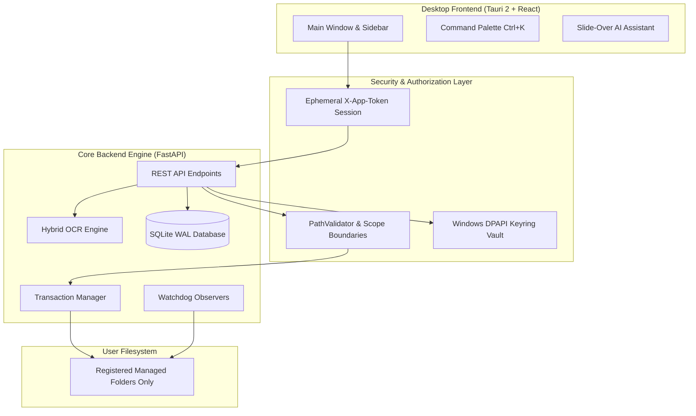

### Core Safety Rules
1. **Managed Folder Confinement:** FileNest only scans, analyzes, or manipulates files inside folders explicitly registered by the user in **Managed Folders**.
2. **Zero Direct Frontend Mutation:** The frontend never executes shell commands or filesystem mutations directly.
3. **Approval-First Execution:** Every multi-file operation (duplicates cleanup, organization, batch rename) is staged as a structured plan in **Review Changes** before execution.
4. **Collision Detection & Rollback:** TOCTOU validation, hash checks, and local quarantine staging prevent accidental data loss and permit one-click undo.

---

## Global Navigation & Shortcuts

FileNest provides an ergonomic, accessible interface with keyboard-driven navigation:

| Keybinding | Action | Description |
|---|---|---|
| `Ctrl + K` / `Cmd + K` | **Command Palette** | Opens the global search overlay to instantly jump to any module, search files, or trigger quick actions. |
| `Escape` | **Close Dialog / Panel** | Closes active modals, preview windows, or the AI Assistant panel. |
| `Alt + 1` .. `Alt + 9` | **Quick Tab Switch** | Jump directly to sidebar modules (Dashboard, Files, Storage, etc.). |
| `F5` / `Ctrl + R` | **Refresh View** | Refreshes directory contents or telemetric data in current module. |

---

## 1. Dashboard Overview

The **Dashboard** serves as the operational mission control, aggregating real-time storage telemetry, historical usage trends, recent activities, and background worker progress.

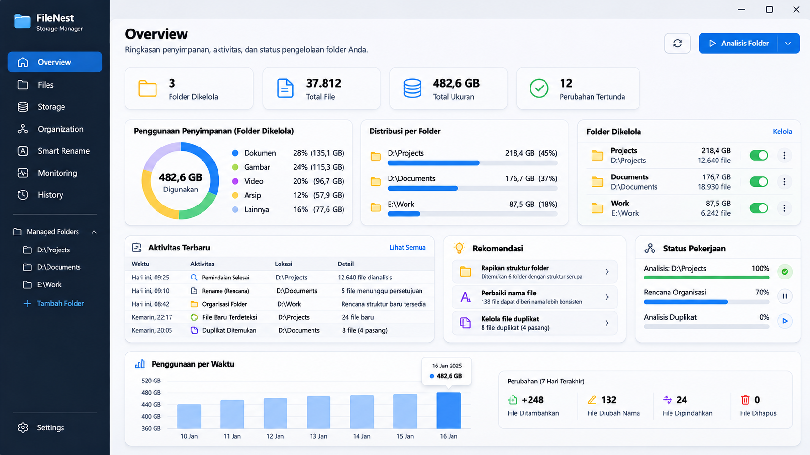

### Key Features
- **Storage Summary Cards:** Displays total managed storage capacity, consumed space, free space, and active managed folder counts.
- **Storage Usage Donut Chart:** Interactive visualization dividing stored data into intuitive file categories (Documents, Media, Archives, Code, System/Other).
- **Storage History Trend:** Time-series graph illustrating storage growth and reclamation over the past 30 days.
- **Managed Folders Summary Table:** Quick table displaying folder paths, file counts, sizes, and health status with direct links to explore or scan.
- **Recent Activities Feed:** Live stream of recently indexed, organized, or renamed files with status badges.
- **Active Background Jobs:** Progress indicators for folder indexing, hash calculations, and OCR batch tasks.
- **Smart Recommendations Widget:** Actionable recommendations (e.g., duplicate clusters identified, empty folders detected, storage threshold warnings) with one-click navigation to fix them.

---

## 2. Files Manager (3-Pane & OCR)

The **Files Manager** is a high-performance, 3-pane native explorer providing directory hierarchy browsing, virtualized file lists, rich metadata inspection, bounded text/image previews, and integrated OCR.

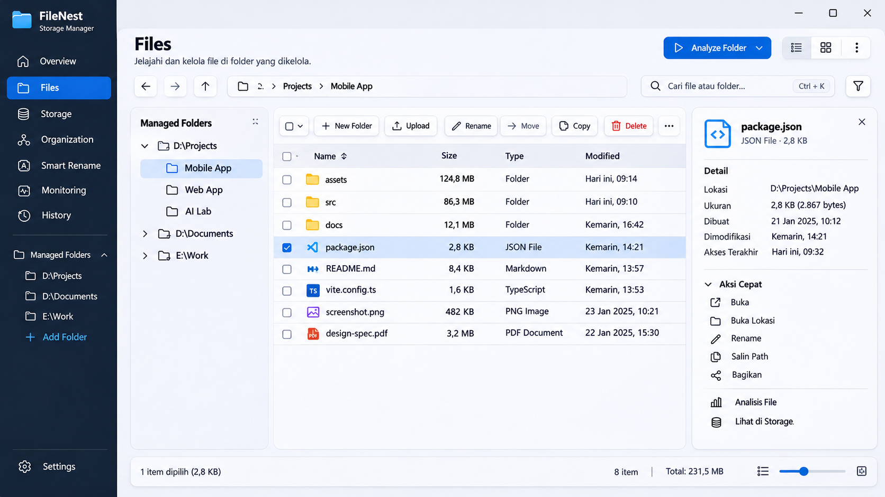

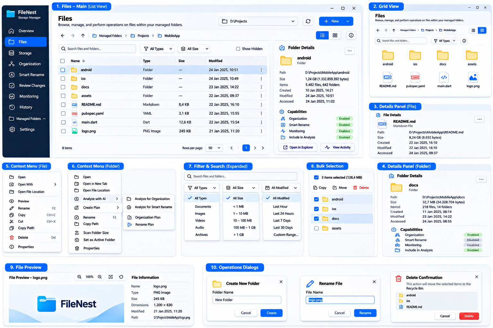

### 3-Pane Layout Breakdown
1. **Left Pane (Folder Tree):** Expandable tree of all registered Managed Folders, displaying directory nesting, item counts, and volume icons.
2. **Center Pane (File Grid & Table):**
   - Toggle between **Detailed Table View** and **Grid View**.
   - Sort by Name, Size, Modified Date, Extension, or Type.
   - Filter by search query, file extension, or file category pills.
   - Right-click context menu: Open, Rename, Move, Copy, Delete, Run OCR, or Ask AI Assistant.
3. **Right Pane (Inspector & Details):**
   - Comprehensive metadata: Canonical path, MIME type, exact byte size, file permissions, creation date, modification date, and SHA-256 hash.
   - **Bounded Image/Text Preview:** Safely streams image thumbnails or text files under strict size caps (max 50 MB, 50 MP pixel budget) to prevent UI freezes or memory exhaustion.
   - **Instant OCR Extraction:** Extracts embedded text from receipts, invoices, screenshots, or PDF pages with one click, copying recognized text or passing it to Smart Rename.

---

## 3. Storage Analyzer & Duplicate Finder

The **Storage Analyzer** scans your managed storage to uncover wasted space, identical file duplicates, unusually large files, and empty directory structures.

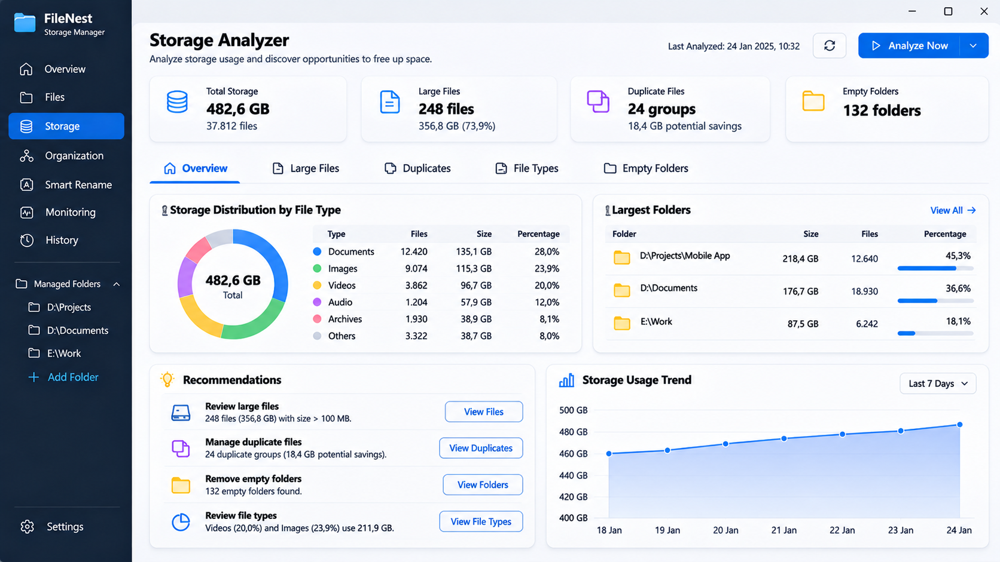

### Feature Breakdown
- **Storage Breakdown:** Categorical charts breaking down storage consumption by file types (`.zip`, `.mp4`, `.pdf`, `.iso`, `.tar`, `.exe`).
- **Duplicate Finder (Content Hash Clustering):**
   - Detects duplicates using a 2-stage verification: first comparing exact byte lengths, then calculating SHA-256 hashes on matched lengths.
   - Groups duplicates together, highlighting the newest, oldest, or shallowest file path.
   - Offers 1-click selection rules: *Keep Newest*, *Keep Oldest*, or *Custom Selection*.
   - **Safety First:** Clicking "Clean Up Duplicates" creates a structured deletion/quarantine plan in **Review Changes** instead of permanently deleting files on the spot.
- **Large Files Explorer:** Ranked table of files exceeding configurable thresholds (e.g., > 100 MB or > 1 GB) with quick action menus to inspect or relocate.
- **Empty Folders Detector:** Identifies abandoned empty directories with safe batch pruning.

---

## 4. Smart Organization Planner

The **Organization Planner** automatically restructures disorganized directories (such as cluttered `Downloads` or `Desktop` folders) into clean, predictable taxonomies.

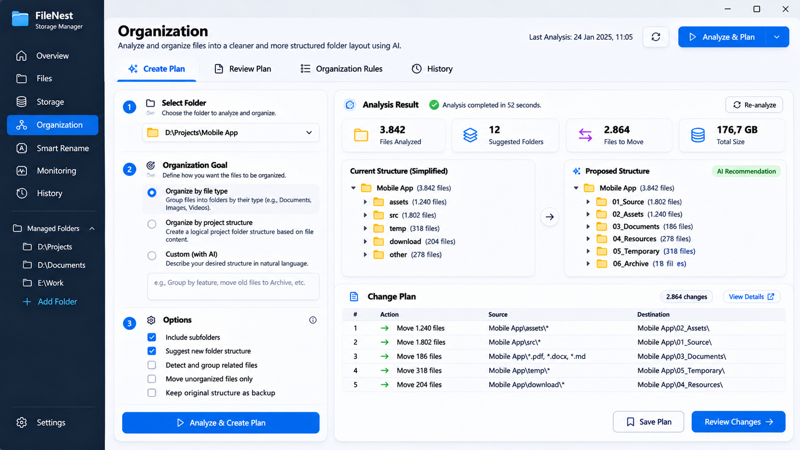

### Reorganization Strategies
- **By Category:** Groups files into standardized subfolders:
  - `Documents/` (`.pdf`, `.docx`, `.xlsx`, `.pptx`, `.txt`, `.md`)
  - `Images/` (`.jpg`, `.png`, `.webp`, `.svg`, `.gif`)
  - `Audio & Video/` (`.mp4`, `.mkv`, `.mp3`, `.wav`)
  - `Archives/` (`.zip`, `.7z`, `.tar`, `.gz`, `.rar`)
  - `Development & Code/` (`.py`, `.ts`, `.rs`, `.json`, `.yaml`)
- **By Date:** Organizes items by Year (`YYYY/`) or Year-Month (`YYYY/MM/`) based on file creation or modification timestamps.
- **Custom Rule Engine:** Users can create custom match rules based on name patterns, extensions, size thresholds, or tags.

### Protected Folder Detection
FileNest actively identifies and protects project repositories and developer tooling from being disorganized:
- Automatically detects `.git/`, `node_modules/`, Python virtual environments (`.venv/`), Android SDKs (`platform-tools`), and IDE workspaces.
- Prevents breaking software projects or deleting critical dependencies by excluding them from broad organization plans.

---

## 5. Smart Rename & Hybrid OCR

The **Smart Rename** module uses optical character recognition and AI to rename cryptically named files (such as `IMG_20261114_001.jpg`, `Scan_0042.pdf`, or generic download hashes) into standardized, human-readable names.

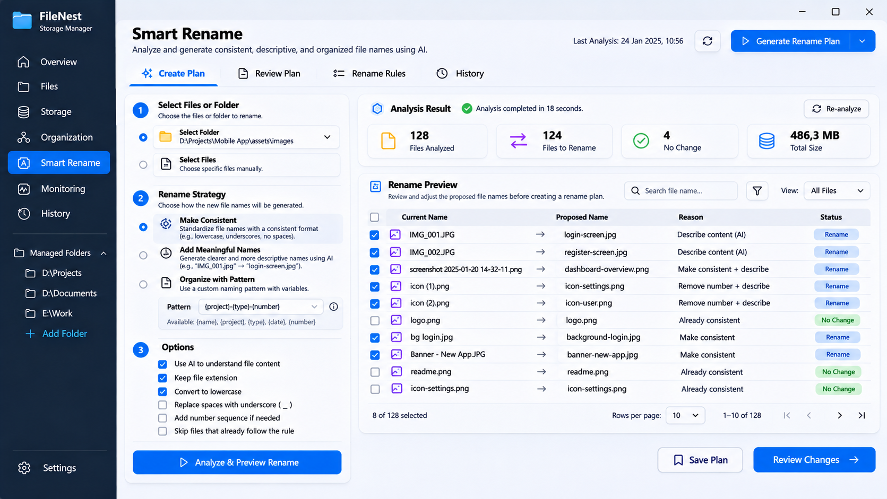

### Hybrid OCR Engine
FileNest utilizes a multi-tiered OCR pipeline tailored for Windows:
1. **Windows Native OCR (`winocr`):** Hardware-accelerated, zero-dependency on-device OCR using the Windows 10/11 WinRT language APIs for instantaneous text extraction.
2. **PaddleOCR (PP-OCRv4):** Offline neural OCR fallback offering high accuracy on complex documents, skewed receipts, and non-Latin scripts.

### Renaming Workflows
- **Single File On-Demand:** Right-click any image or PDF in Files Manager -> *Smart Rename*. The modal displays the document preview, extracted text snippets, and suggested descriptive filenames (e.g., `2026-11-14_Invoice_AcmeCorp_INV-8912.pdf`).
- **Batch Processing:** Select multiple files or an entire folder. FileNest runs OCR in a background thread pool, presents candidate names in a side-by-side diff table, checks for naming collisions, and queues the approved rename plan into **Review Changes**.

---

## 6. Review Changes & Transaction Manager

The **Review Changes** module acts as the human-in-the-loop gatekeeper. No destructive or multi-file operation ever bypasses this screen.

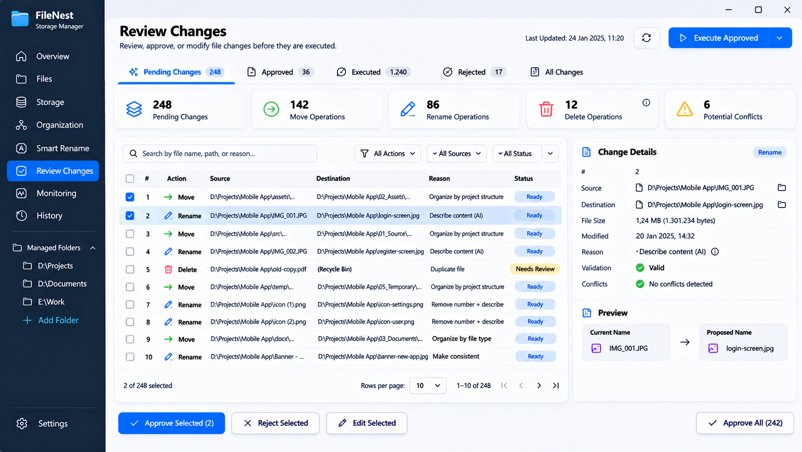

### The Transaction Pipeline

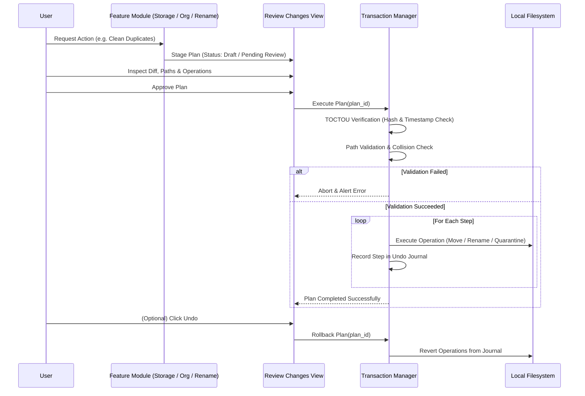

### Key Capabilities
- **Side-by-Side Diff Inspection:** Review original paths versus proposed destination paths, operation types (Move, Rename, Quarantine Delete), and affected byte counts.
- **Collision Warning & Auto-Resolution:** Automatically detects if a target filename already exists and offers non-destructive disambiguation (e.g., adding `(1)`, `(2)`).
- **Local Quarantine Staging:** Files slated for deletion are moved into a designated, hidden quarantine directory inside the Managed Folder rather than permanently unlinked.
- **Atomic Rollback on Error:** If any step fails during execution (e.g., file lock by another process, permission denied), the Transaction Manager automatically rolls back already completed steps.
- **Post-Execution Undo:** Completed transactions can be fully undone from this screen or from the **History** tab at any time.

---

## 7. Real-Time Monitoring & Rules Automation

The **Monitoring** module leverages Windows native filesystem notifications via Python's `watchdog` to track live changes within all registered Managed Folders.

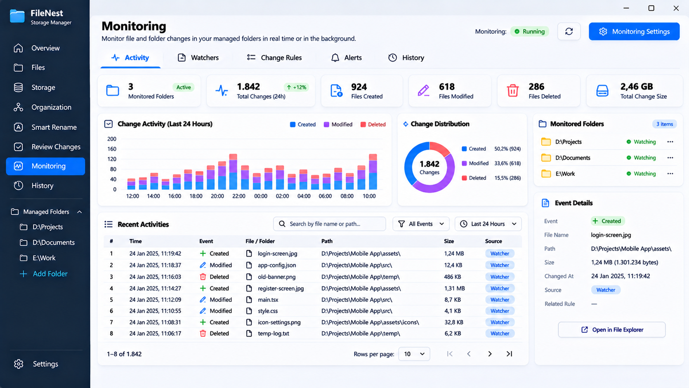

### Capabilities
- **Live Event Stream:** Real-time log of filesystem events (`CREATED`, `MODIFIED`, `DELETED`, `MOVED`) with microsecond timestamps and file metadata.
- **Event Distribution Metrics:** Real-time visual graphs displaying event frequency, busiest folders, and most active file extensions.
- **Configurable Debounce & Ignore Patterns:** Built-in debouncing suppresses duplicate events from temporary files, `.tmp`, `.crdownload`, and editor autosaves.
- **Automation Rules:**
  - Create triggers (e.g., "When a `.torrent` or `.zip` is created in `Downloads`, automatically stage an organization plan").
  - **Risk Divergence:** If an automated rule encounters a naming collision or risk, it does not silently fail or overwrite—it immediately diverts the action to **Review Changes** for manual approval.

---

## 8. Audit & Execution History

The **History** module maintains a tamper-resistant, queryable audit log of every operation performed by FileNest since installation.

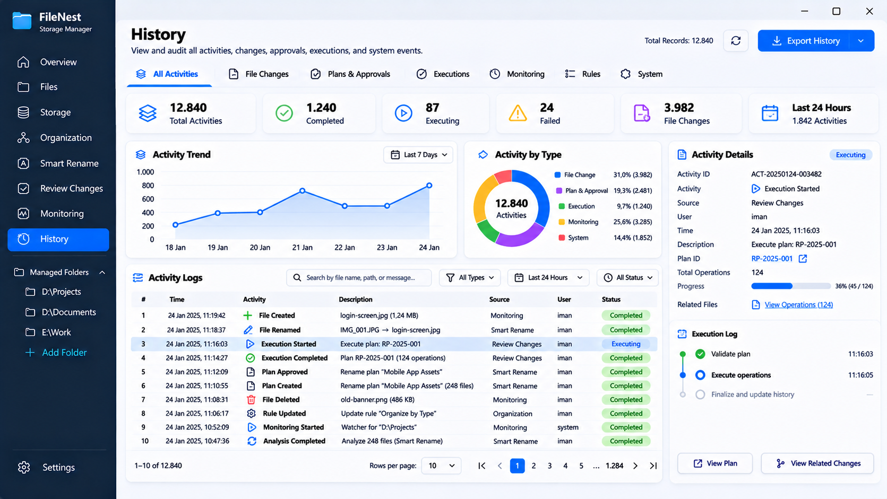

### Features
- **Comprehensive Audit Trail:** Records transaction ID, timestamp, trigger source (Manual UI, Automated Rule, AI Assistant), affected file count, status (`SUCCESS`, `FAILED`, `ROLLED_BACK`), and duration.
- **Detailed Step Breakdown:** Click any transaction row to inspect every individual step, old path, new path, file hash, and error message.
- **One-Click Transaction Rollback:** Revert any past transaction with a single click. The Transaction Manager re-verifies that files have not been modified since the transaction before reverting them safely to their original paths.
- **Search & Filter:** Filter history by date range, operation status, folder, or keyword.

---

## 9. Managed Folders

The **Managed Folders** view controls the exact filesystem boundaries FileNest is authorized to access.

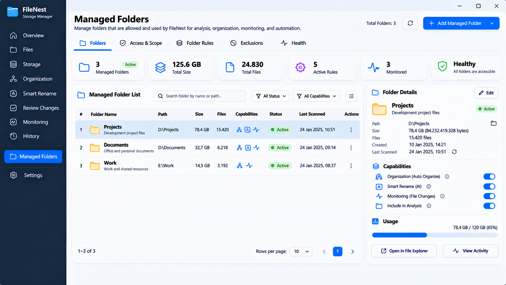

### Boundary Controls
- **Folder Registration:** Add folders using the native Windows directory picker (`@tauri-apps/plugin-dialog`).
- **Drive Root Detection:** Supports registering whole non-system drives (e.g., `D:\`, `E:\`, `F:\`) while automatically subsuming child folders to avoid redundant scans.
- **System Directory Protection:** Hardcoded protections block registering `C:\Windows`, `C:\Program Files`, `C:\Program Files (x86)`, `C:\Users\...\AppData`, root system drives (`C:\`), or recovery partitions.
- **Inclusion & Exclusion Rules:** Configure specific subdirectories or file patterns to ignore (e.g., ignore `.git`, `node_modules`, `cache`).
- **Storage Quota & Rescan Controls:** Trigger on-demand deep rescans or inspect indexing progress per folder.

---

## 10. Settings & Security

The **Settings** module provides granular control over AI gateway connections, credential management, performance limits, and Windows desktop integration.

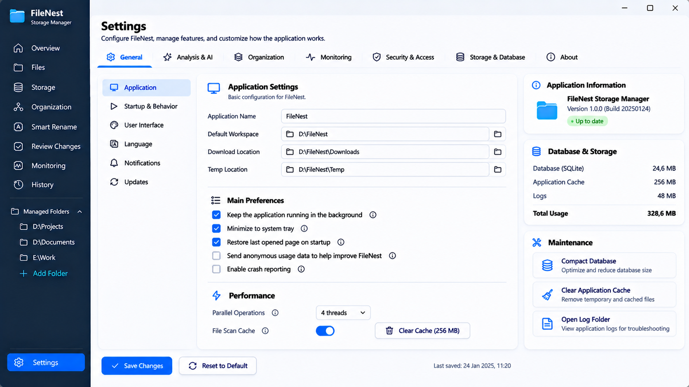

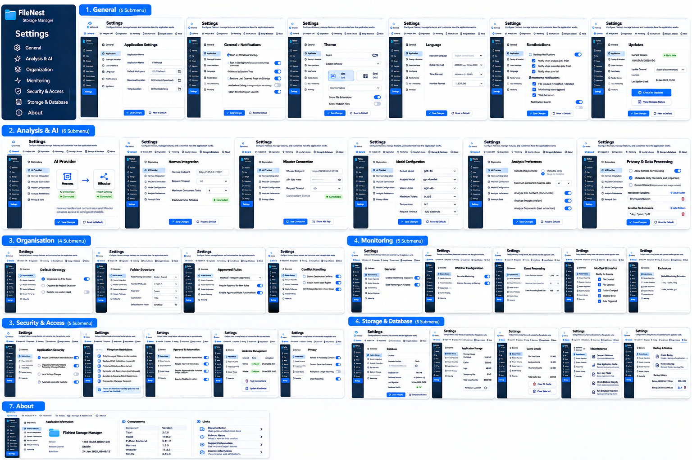

### Configuration Sections
1. **AI & Gateway Settings:**
   - Configure **9Router** (OpenAI-compatible local gateway) and optional **OpenRouter** fallback endpoints.
   - Select models for metadata analysis, classification, and naming suggestions (e.g., `gpt-4o-mini`, `gemini-1.5-flash`, `qwen-2.5-coder`).
   - Test connectivity with zero-token probe checks.
2. **Credential Vault (Windows DPAPI):**
   - API keys are securely stored in the **Windows Credential Manager** via the `keyring` library with Windows DPAPI encryption.
   - Keys are never stored in plaintext `.env` files, SQLite databases, browser `localStorage`, or application logs.
3. **Scanning & Performance Limits:**
   - Configure maximum file size for OCR inspection (default: 50 MB).
   - Configure image decompression pixel budget (default: 50 MP) to defend against decompression bombs.
   - Set thread pool concurrency for hashing and thumbnail generation.
4. **Desktop Integration:**
   - Toggle **Run on Windows Startup** (`HKCU\Software\Microsoft\Windows\CurrentVersion\Run`).
   - Toggle **Minimize to System Tray** on window close.
   - Select application theme: Light, Dark, or System Sync.

---

## Contextual AI Assistant Panel

FileNest features an integrated slide-over **AI Assistant Panel** accessible from the top-right header or by right-clicking any file/folder and choosing *Ask AI Assistant*.

### Restricted MCP Architecture
- **Read-Only Metadata & Structured Planning Only:** The AI assistant does **not** have shell execution access, raw Python evaluation, or direct file write/delete permissions.
- **Restricted Tool Layer:** The AI interacts exclusively through predefined Model Context Protocol (MCP) tools:
  - `get_folder_summary(folder_id)`: Summarizes file types and counts.
  - `plan_organization(folder_id, strategy)`: Generates a proposed organization plan.
  - `plan_smart_rename(file_ids, naming_convention)`: Generates candidate rename proposals.
  - `get_storage_recommendations(folder_id)`: Analyzes waste and duplicate clusters.
- All plans proposed by the AI assistant are routed directly to **Review Changes** for explicit user review and approval before execution.

---

## Step-by-Step Practical Recipes

### Recipe 1: Registering Your First Folder
1. Launch FileNest and navigate to **Managed Folders** in the left sidebar.
2. Click the **Register Folder** button (`FolderPlus` icon).
3. Select your desired directory (e.g., `D:\Documents` or `D:\Downloads`) in the native Windows folder picker.
4. FileNest verifies the path is not a protected system folder, initializes an index in SQLite, and launches an asynchronous metadata scanner.
5. Watch the real-time indexing progress in the Dashboard or Managed Folders view.

### Recipe 2: Cleaning Up Duplicates Safely
1. Navigate to **Storage** -> **Duplicates** tab.
2. Review duplicate clusters grouped by identical SHA-256 hashes.
3. Use the quick selection dropdown: choose **Keep Newest** or manually check files to remove.
4. Click **Create Cleanup Plan**.
5. The view transitions to **Review Changes**. Verify the target files, destinations, and quarantine mode.
6. Click **Approve & Execute**. Files are safely moved to the local quarantine area.
7. If you ever need them back, navigate to **History** and click **Undo Transaction**.

### Recipe 3: Organizing a Cluttered Downloads Folder
1. Navigate to **Organization** -> **Analyze** tab.
2. Select your `Downloads` folder from the dropdown.
3. Choose the **By Category** strategy.
4. Click **Analyze & Generate Plan**.
5. FileNest analyzes all files, verifies protected directories (like `.git` or SDKs) are left untouched, and creates a plan.
6. Open **Review Changes** to preview where files will be moved.
7. Click **Execute Plan**. Your files are instantly organized into tidy category folders.

### Recipe 4: Batch Renaming Scanned Documents with OCR
1. Navigate to **Smart Rename** -> **Batch Rename** tab.
2. Select your folder of scanned receipts or PDFs.
3. Choose the OCR mode: **Windows Native OCR** (recommended for speed) or **PaddleOCR** (for maximum accuracy).
4. Click **Scan & Generate Suggestions**.
5. Review the side-by-side table displaying Original Filenames, Extracted Keywords, and Proposed Names.
6. Double-click any proposed name to edit it manually if desired.
7. Click **Stage in Review Changes**, verify there are no collisions, and click **Execute**.

---

## Safety Guarantees & FAQ

### Q: Can FileNest delete files permanently without my consent?
**No.** FileNest has a strict non-destructive policy. Automated rules and AI recommendations are diverted to **Review Changes** upon any risk. Deletions use a hidden quarantine staging mechanism that preserves files for recovery.

### Q: Does FileNest send my files or documents to cloud AI servers?
**No.** File content never leaves your computer unless you explicitly configure an external model gateway in Settings. OCR is performed 100% locally on your machine via Windows Native OCR or local PaddleOCR. When AI planning is enabled via 9Router, only file metadata (names, sizes, extensions) is shared with the configured model.

### Q: What happens if a file is open or locked during a transaction?
The Transaction Manager performs a TOCTOU (Time-of-Check to Time-of-Use) check. If a file cannot be moved or renamed due to an OS lock, the transaction immediately halts and rolls back any steps already executed in that batch, leaving your disk in a clean, consistent state.

### Q: Where is my data and configuration stored?
- **Database:** Local SQLite database with WAL (Write-Ahead Logging) stored in your local application data folder.
- **Credentials:** Windows Credential Manager (DPAPI encrypted).
- **Logs:** Redacted local text logs with automatic rotation and sensitive token masking.
